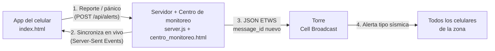
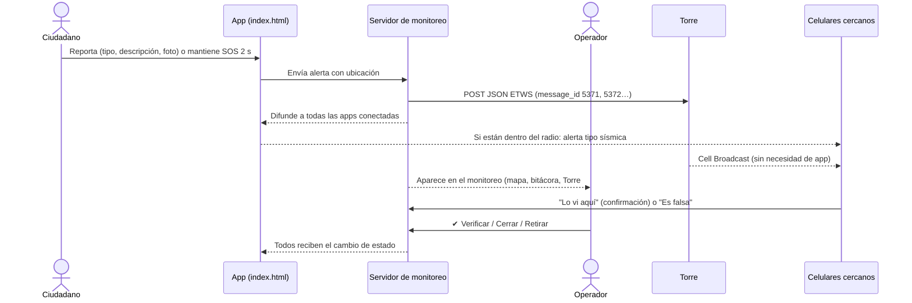

# ALERTA CERCA
**Sistema Inteligente de Alertamiento Comunitario por Proximidad** · HackaITLAC 2026

> *"Si algo importante está ocurriendo cerca de ti, deberías poder saberlo."*

## Arquitectura



## Flujo de una alerta



1. **Ocurre un acontecimiento.** Un ciudadano lo reporta desde la app (tipo, descripción, foto y ubicación) o activa el **botón de pánico**.
2. **Se genera la alerta.** Llega al servidor y aparece al instante en el **centro de monitoreo**.
3. **Se geolocaliza y se clasifica.** Cada tipo tiene un nivel (crítico, alto o medio) y un **radio inicial** (1, 2 o 3 km).
4. **Se transmite por la torre.** El servidor manda el JSON ETWS con un `message_id` nuevo y la alerta llega a todos los celulares de la zona por Cell Broadcast.
5. **Llega a los usuarios cercanos.** Quien está dentro del radio recibe el aviso según el nivel: desde un aviso discreto (Informativa) hasta pantalla completa con sirena (Crítica).
6. **El radio crece.** Si la situación no se resuelve, el radio se amplía (1 → 3 → 5 → 10 km).
7. **La comunidad colabora.** Los usuarios pueden confirmar ("lo vi aquí") o reportar la alerta como falsa (con 3 reportes se retira sola).
8. **El operador valida.** Desde el monitoreo puede **verificar**, **cerrar como resuelta** o **retirar** la alerta, y todos reciben el cambio.
9. **Botón de pánico.** Comparte la ubicación en vivo; el monitoreo dibuja el recorrido. Se desactiva con PIN ("Estoy a salvo").

## Niveles de alertamiento (objetivo 3)
El **tipo** de acontecimiento (qué pasó) es independiente del **nivel** (qué tan grave es). Cada categoría tiene un nivel por defecto, y el operador puede subirlo o bajarlo.

| Nivel | Radio (km) | Se amplía cada | Aviso en el celular | Torre celular (Cell Broadcast) |
|---|---|---|---|---|
|  Informativa | 0.5 → 1 | 30 min | Aviso discreto en la lista | Nunca |
|  Precaución | 1 → 2 → 3 | 20 min | Banner con tono suave | Nunca |
| Urgente | 1 → 3 → 5 | 15 min | Pantalla completa con alarma | Solo si un operador la verifica |
| Crítica | 1 → 3 → 5 → 10 | 10 min | Pantalla completa, sirena y vibración larga | Sí, si es oficial o verificada |

> En la demo el tiempo corre 90 veces más rápido (15 min → 10 s).

## Catálogo de categorías
| Grupo | Categorías (nivel por defecto) |
|---|---|
| Personas | Desaparición o posible sustracción de menor (Crítica) · Persona desaparecida (Urgente) · Adulto mayor o persona vulnerable extraviada (Urgente) · Botón de pánico (Crítica) |
| Seguridad | Robo de vehículo (Urgente) · Robo a casa o comercio (Precaución) · Asalto o situación de riesgo (Urgente) |
| Siniestros y emergencias | Incendio (Urgente) · Accidente o emergencia relevante (Precaución) · Evacuación (Crítica) |
| Fenómenos naturales y riesgos ambientales | Inundación (Urgente) · Fenómeno natural (Urgente) · Riesgo ambiental (Precaución) |
| Otras | Otra situación de riesgo (Informativa) |

## Confiabilidad y prevención de alertas falsas (objetivos 7, 8 y 9)
**Índice de confiabilidad (0–100)**, calculado en el servidor y visible para el ciudadano y el operador:

| Factor | Puntos |
|---|---|
| Reporte ciudadano (base) / emitida por el monitoreo | +25 / +60 |
| Cada confirmación "lo vi aquí" de otro dispositivo (máx. 4) | +12 |
| Evidencia adjunta (foto) | +10 |
| Descripción detallada | +5 |
| Historial del dispositivo (reportes confiables − falsos) | −40 a +20 |
| Cada reporte de información falsa | −15 |
| Verificada por un operador | 95 |

**Distinción visual para el ciudadano:** en la app, cada alerta muestra **"ALERTA VERIFICADA"** (verde, borde sólido) o **"REPORTE CIUDADANO SIN CONFIRMAR"** (ámbar, borde punteado), con su índice de confiabilidad.

**Antiduplicados:** si llega un reporte de la misma categoría a menos de **300 m** y **30 min** de otro activo, no se crea una alerta nueva: se suma como confirmación. En producción, con PostgreSQL + PostGIS:
```sql
SELECT id FROM alertas
 WHERE estado = 'activa' AND categoria = $1
   AND creada > now() - make_interval(mins => 30)
   AND ST_DWithin(ubicacion::geography, ST_SetSRID(ST_MakePoint($lng, $lat), 4326)::geography, 300)
 ORDER BY ubicacion <-> ST_SetSRID(ST_MakePoint($lng, $lat), 4326)
 LIMIT 1;
```

**Antiabuso por dispositivo** (la app es anónima, así que el identificador del dispositivo es el único control):
- Máximo **3 reportes cada 10 minutos** por dispositivo.
- Un dispositivo no puede confirmar su propio reporte ni confirmar o denunciar dos veces la misma alerta.
- **Reputación** del dispositivo: sube con reportes verificados y baja con reportes retirados por falsos.
- **Bloqueo automático 24 h** tras 2 reportes falsos; el operador también puede bloquear o desbloquear manualmente.
- **Integridad de la app:** en producción, cada reporte lleva un token de **Play Integrity** (Android) o **App Attest** (iOS) que el servidor valida. En el prototipo web se marca como "simulada".
- Las acciones de operador (verificar, retirar, cambiar nivel, autorizar datos, enviar a la torre) solo se aceptan desde el centro de monitoreo.

**Caducidad:** un reporte ciudadano que no recibe al menos 2 confirmaciones ni es verificado caduca a los **20 minutos** y deja de mostrarse.

Todo es configurable al iniciar el servidor: `RATE_MAX`, `RATE_MIN`, `DUP_M`, `DUP_MIN`, `EXPIRE_MIN`, `BLOCK_AFTER`, `BLOCK_HOURS`.

## Datos autorizados de terceros (objetivo 6 y LFPDPPP)
En las categorías de **personas** (menores, personas desaparecidas, adultos mayores):
1. El ciudadano puede reportar con foto y descripción, pero esos datos **quedan en resguardo**: solo los ve el centro de monitoreo. La comunidad recibe la alerta con un texto genérico.
2. Un **operador verificado** publica los datos únicamente cuando el **familiar o tutor autoriza**. Registra su nombre y parentesco, y queda constancia de quién validó y cuándo.
3. Si es el propio centro de monitoreo quien emite la alerta, debe capturar esa autorización antes de enviarla.

## Archivos
| Archivo | Qué es |
|---|---|
| `index.html` | App del celular (también funciona publicada en GitHub Pages) |
| `centro_monitoreo.html` | Centro de monitoreo: alertas en vivo, historial y zonas de riesgo |
| `server.js` | Servidor: recibe alertas, sincroniza las pantallas y envía a la torre. Solo necesita Node.js |
| `config.json` | Se crea solo. Guarda la IP de la torre y las URLs |

## Cómo correrlo
```bash
node server.js                  # usa la IP de la torre guardada en config.json
node server.js 192.168.3.200    # cambia la IP de la torre y la guarda
```
- Monitoreo: `http://localhost:3000`
- App: `http://IP-DE-LA-PC:3000/app`, o desde el QR en **Conectar celular**

La IP de la torre también se cambia desde el monitoreo: **Conectar celular → ⚙️ Torre → Guardar IP**.

## App desde GitHub Pages
GitHub Pages es HTTPS, y el navegador no deja que una página HTTPS hable con un servidor `http://`. Por eso el servidor necesita una dirección HTTPS mediante un túnel gratuito:
```bash
npx cloudflared tunnel --url http://localhost:3000
```
Copia la dirección `https://….trycloudflare.com` en **Conectar celular → App desde GitHub Pages** junto con la URL de tu página. Se genera un QR que abre la app de GitHub ya conectada al servidor. Con HTTPS, además, **funciona el GPS real** del celular.

> Nota: el historial de 90 días y las zonas de riesgo del monitoreo son datos simulados para la demostración. Las alertas en vivo sí vienen de las apps.